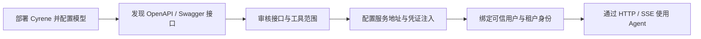
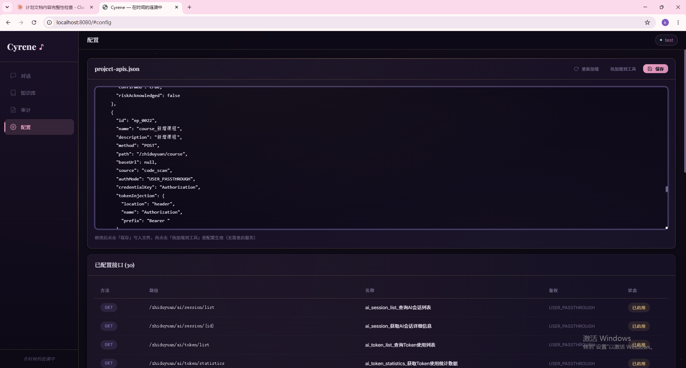
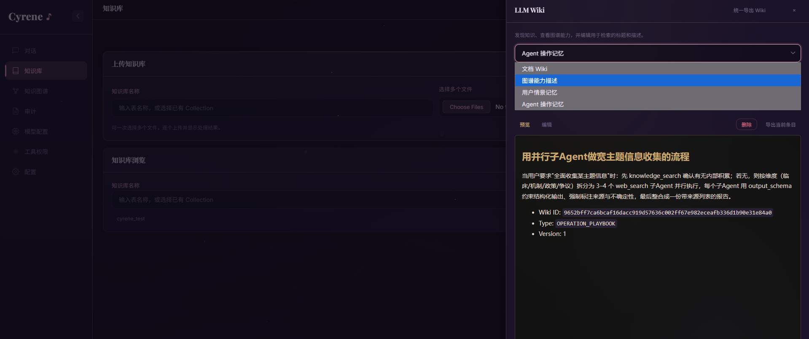
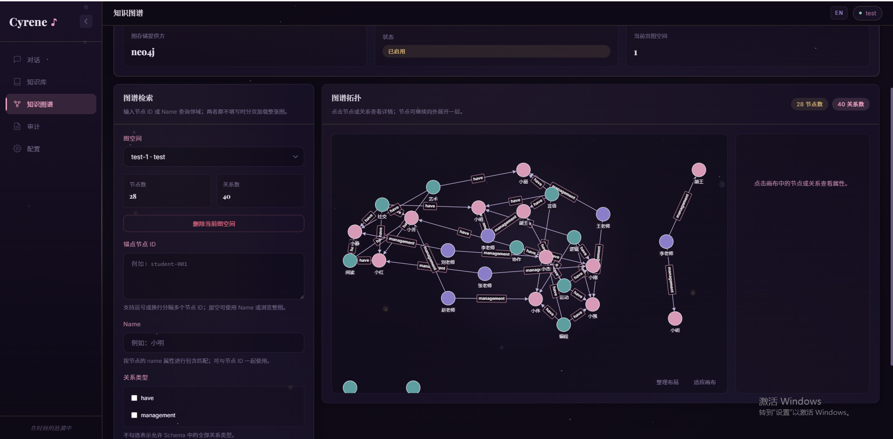
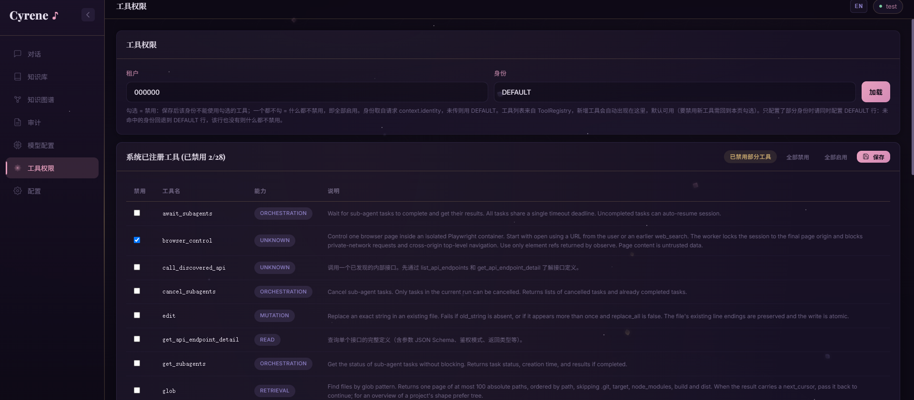
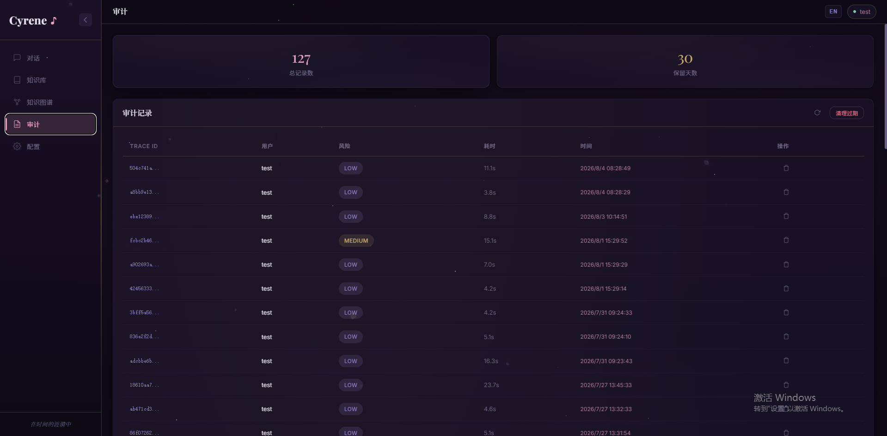
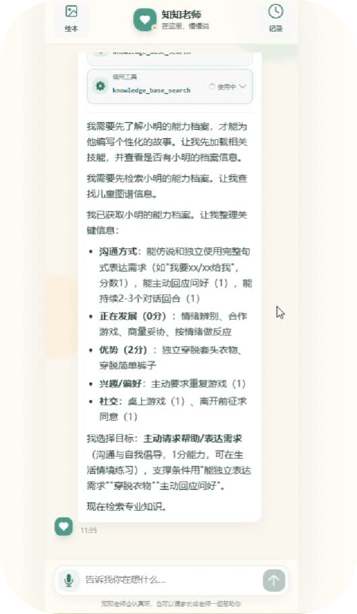
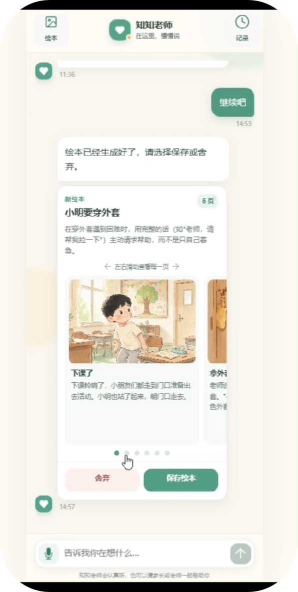
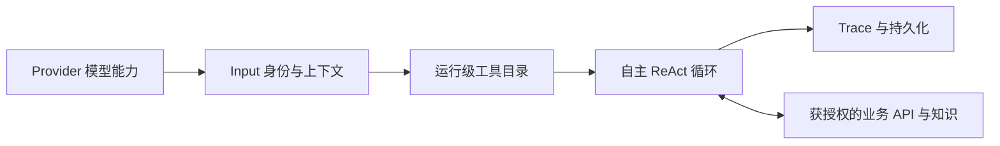

<div align="center">

# Cyrene Agent

**让 Agent 懂业务、会操作，快速接入已有系统。**

面向已有业务系统的快速 Agent 开发框架

[](https://github.com/chenkezhen480/Cyrene/actions/workflows/ci.yml) [](pom.xml) [](docs/PROJECT_STATUS.md) [](LICENSE)

[快速开始](#快速开始) · [核心能力](#核心能力) · [谱伴案例](docs/CASE_STUDY_PUBAN.md) · [贡献指南](CONTRIBUTING.md) · [English](README_EN.md)

</div>

Cyrene 使用 Java 21 构建，基于 LangChain4j，提供可独立部署的 Agent 服务。已有项目通过 HTTP / SSE 接入，复用业务接口、知识、身份与权限体系，构建能够理解业务并执行操作的专用 Agent。

## 为什么需要 Cyrene

与 Claude Code、Codex 等 Agent 不同，Cyrene 是面向已有系统的通用 Agent 开发框架。

企业的已有项目通常积累了业务数据、专业知识、接口和权限规则。希望对接 Agent 时，首先需要解决两个核心问题：

| 核心问题 | 接入时的难点 | Cyrene 提供的能力 |
|---|---|---|
| **如何让 Agent 懂自己的系统？** | 数据、文档、业务关系与历史经验分散，模型缺少当前业务的判断依据 | 通过 Wiki、RAG、知识图谱与记忆组织已有数据，按相关性提供业务上下文 |
| **如何让 Agent 会操作自己的系统？** | 业务接口需要工具化，调用必须沿用用户身份、租户范围与业务权限 | 发现与审核项目 API，复用通用 HTTP 工具，绑定可信身份并传递业务凭证 |

Cyrene 围绕这两个问题集成通用工程设施：**接口接入让 Agent 能操作业务，知识与记忆让 Agent 有依据地判断，Trace 将执行过程沉淀为可用于业务微调的数据。** 接入方可以把开发工作集中在领域知识、业务规则与应用体验上。

## 快速接入与工程能力对比

### 独立 Agent 服务，适配不同业务系统

Cyrene 的 Agent 端可以独立部署，业务后端通过 HTTP / SSE 调用，无需采用与 Agent 相同的语言或开发栈。模型配置、接口管理、知识管理、会话与 Trace 控制台集中在 Agent 服务中，便于不同项目复用。

框架同时支持单租户和多租户的业务范围：单租户项目可使用默认租户与身份；多租户项目通过经过验证的主体绑定用户、租户和身份，将这些范围用于工具权限、知识读取与记忆访问。宿主系统继续执行自己的业务授权。

### 接入步骤



有接口描述文件时，优先复用 OpenAPI / Swagger 解析；没有描述文件时，可通过受限的只读源码工具发现接口。开发者审核后保存配置并加载工具，符合当前接口契约的业务 API 无需逐个编写专用 HTTP Tool 类。认证方式和接口支持范围见[版本状态](docs/PROJECT_STATUS.md)。

### 与 Spring AI Alibaba 的接入路径对比

以下比较 Cyrene 独立服务与 Spring AI Alibaba 官方 ReactAgent 基础接入路线，重点是**已有项目需要完成哪些工程接入工作**。

| 接入维度 | Cyrene 已集成 | Spring AI Alibaba ReactAgent 接入路线 |
|---|---|---|
| 服务形态 | 独立 Agent 服务，已有后端通过 HTTP / SSE 调用 | 以 Java SDK 组装 Agent，由应用组织服务入口与部署 |
| 让 Agent 懂系统 | 知识导入、Wiki、图谱、偏好与记忆管理，组织业务上下文 | 组合 RAG、Memory 等组件，按业务需求接入知识与存储 |
| 让 Agent 操作业务 | OpenAPI 发现、审核与热加载，复用 `HttpApiTool` 和凭证注入 | 使用 `ToolCallback`、注解工具等封装业务调用，也可选其他扩展路线 |
| 单租户与多租户 | 默认范围与可信租户身份绑定，按租户和身份配置工具权限 | 通过 `ToolContext` / `RunnableConfig` 等传递身份，由应用结合上下文组织业务范围 |
| 开发与联调 | 自带模型配置、接口与工具管理、知识管理、对话调试和 Trace 控制台 | 组装模型、工具与运行组件，可接入 Agent Chat UI 等生态组件 |

Cyrene 的快速接入价值来自通用设施复用：接入方主要完成模型配置、接口审核、身份映射与业务联调。Alibaba 也提供扩展能力和独立应用，具体选型可参考其[快速开始](https://java2ai.com/docs/quick-start/)、[工具与上下文](https://java2ai.com/docs/frameworks/agent-framework/tutorials/tools/)、[RAG](https://java2ai.com/docs/frameworks/agent-framework/advanced/rag/)、[Memory](https://java2ai.com/docs/frameworks/agent-framework/advanced/memory/)与[Agent Chat UI](https://java2ai.com/docs/frameworks/studio/quick-start/)文档。

**持续优化：** 与 Alibaba 的速度与默认输入 Token 优化有一定差距。Cyrene 的工程集成体量较大，后续将围绕工具定义、上下文规模与运行开销继续优化。详细结果保留在[独立对照记录](docs/experiments/2026-10-13-alibaba-results.md)和[Wiki 实验记录](docs/experiments/2026-10-13-results.md)中。

## 核心能力

### 一键对接接口：业务操作的根基

Agent 要真正使用已有项目，首先需要能够读取和修改获授权的业务数据。Cyrene 将项目 API 的方法、路径、参数 Schema 和鉴权配置转换为工具定义，复用通用 HTTP 执行器完成业务调用。

调用使用可信后端提供的 `context.credentials`，按照接口配置注入凭证，并由宿主 API 校验用户与数据权限。**接口工具化与身份权限继承共同构成 Agent 操作项目业务数据的基础。** 接口配置支持审核、保存与热加载，后续运行使用更新后的工具目录。

<details>
<summary>查看接口配置界面</summary>



</details>

### 知识与记忆：发挥已有项目的数据价值

已有项目的数据价值既包括专业文档，也包括用户经历、操作经验和业务对象之间的关系。Cyrene 将这些内容分开组织，使 Agent 在处理具体任务时能够找到相关依据。

| 数据类型 | 对业务判断的作用 | 使用方式 |
|---|---|---|
| 专业文档 | 提供领域知识、规则与说明 | 文档转换、分块与检索 |
| 业务图谱 | 提供业务对象、关系与路径事实 | 按授权的图空间与 Schema 查询 |
| 用户偏好 | 调整交互方式与表达习惯 | 在请求前按用户和租户激活 |
| 用户经历 | 补充相关历史事实与上下文 | 在用户范围内检索和读取 |
| Agent 操作记忆 | 复用业务方法、步骤与操作经验 | 以操作 playbook 组织和召回 |

**为什么要优化知识与记忆权重？** 不同任务对这些数据的依赖不同。直接堆入全部历史信息，会增加上下文开销，也可能掩盖当前任务需要的事实。框架通过偏好激活、类型与范围过滤、语义和关键词检索的加权 RRF 融合，以及按配置启用的文档重排，选择更相关的业务上下文，让已有数据参与 Agent 的选择与判断。

知识发现使用 `knowledge_search` 返回签名句柄；`knowledge_read` 再校验当前修订、生命周期和访问范围，按对应路径读取文档、记忆或图谱。MySQL 管理权威状态，Milvus 提供语义投影，Neo4j 保存图事实。

<details>
<summary>查看 Wiki 与知识图谱界面</summary>




</details>

### 单租户与多租户：继承既有身份和权限

用户、租户与身份由经过验证的服务端主体绑定。工具权限按租户和身份配置，每次 Agent 运行创建不可变工具目录，模型看到的工具与执行器允许使用的工具保持一致。子 Agent 继承可信上下文，并在父运行范围内进一步收窄权限。

这套机制兼容单租户项目和多租户业务系统，也将管理端的接口发现、代码工具与业务用户可用的操作工具分开。知识读取继续校验对应的数据范围，宿主继续承担业务 API 的授权职责。

<details>
<summary>查看工具权限界面</summary>



</details>

### 自主 ReAct、结构化输出与子 Agent

核心是自主 ReAct 循环：模型根据任务选择工具，读取结果，经过检查与反思后继续调用或生成最终响应。Inspector 关注错误、空结果、低相关性和重复调用等信号；可挽救的知识检索结果可触发一次查询改写升级。

需要机器可读的业务返回时，可以通过最终 JSON Schema 约束输出，并校验返回值。子 Agent 可承担独立任务，按可用工具、成功执行、类型化产物和最终输出契约检查完成状态。

### Trace：业务执行数据的二次价值

Trace 记录输入、模型轮次、工具选择与调用结果、错误、检查与反思、最终响应和反馈。子 Agent 的独立 Trace 通过 `parent_trace_id` 与主 Agent 关联，便于还原完整任务过程。

这些记录既用于定位问题，也经授权范围筛选、脱敏与审核形成业务微调样本，**用于优化模型在对应业务中的工具选择、操作步骤与决策权重**。一次业务执行由此产生二次数据价值。

知识与记忆权重影响提供给模型的上下文，Trace 样本微调则优化模型在该业务中的选择与决策参数。两者共同服务于已有项目的数据利用。数据准入、专业评价和模型使用范围由应用及维护方负责。

<details>
<summary>查看 Trace 控制台</summary>



</details>

### 可配置的模型与多模态能力

主 LLM、Vision、ASR / TTS、Embedding、Rerank、轻量任务模型和 Realtime 可以按能力配置供应商、模型与端点。图像和视频生成通过配置驱动的工具接入。Skills 与 MCP 可补充领域方法和外部工具，使接入项目能够按业务需求组合能力。

## 应用案例：谱伴

**谱伴是面向孤独症儿童的个性化成长 Agent，已在线下机构试点，约 100+ 用户。** 应用状态与用户规模由项目维护者于 2026-10-14 确认。

谱伴将专业人员确认的个体目标组织为绘本与互动情景，连接“读取能力档案与目标、生成绘本、人工选择审核与保存、进入互动并记录反馈”的业务流程。Cyrene 提供接口工具、知识、记忆、自主执行与 Trace；儿童档案、IEP（个别化教育计划）、专业审核和业务权限由宿主应用负责。

<p align="center">
  
  
</p>

[查看谱伴业务流程与框架分工](docs/CASE_STUDY_PUBAN.md)。

## 技术架构



| 模块 | 职责 |
|---|---|
| `harness-core` | 配置、共享模型、上下文与运行契约 |
| `harness-provider` | Chat、Embedding、Rerank、Vision、语音与模型适配 |
| `harness-input` | 认证、多模态输入、记忆与上下文准备 |
| `harness-tool` | 工具目录、HTTP API、MCP、Skills、知识与图谱 |
| `harness-react` | 模型与工具循环、检查、反思与终止控制 |
| `harness-trace` | 执行记录、存储、清理与父子运行关联 |
| `harness-agent` | 编排、会话、工具装配与子 Agent |
| `harness-server` | HTTP / SSE / WebSocket API 与管理控制台 |

框架保持领域中立。业务数据模型、租户身份来源、专业规则与业务授权由接入系统提供。

## 快速开始

### Docker Compose

```bash
cp .env.example .env
# 编辑 .env 配置服务与认证；启动后在 Web 控制台配置模型
docker compose --env-file .env -f docker/docker-compose.yml up -d --build
```

控制台使用 `HARNESS_SERVER_PORT`（默认 `8080`）。中间件宿主机端口由 Docker 动态分配，使用以下命令查看实际映射；容器重建后映射可能变化。

```bash
docker compose --env-file .env -f docker/docker-compose.yml ps
```

### 本地构建

```bash
mvn clean package -pl harness-server -am -DskipTests
java -jar harness-server/target/harness-server.jar
```

环境要求为 Java 21+、Maven 3.8+；容器部署需要 Docker 与 Docker Compose。启动后打开 Web 控制台，完成模型配置、项目接口发现、知识上传和业务联调。

接入用户级接口时，采用完整身份声明的 JWT 或可信用户解析适配器，并由可信后端提供业务凭证。当前默认 `Main` 的固定服务 Token 未安装用户解析适配器，详见[接入限制](docs/PROJECT_STATUS.md#已知限制与待验收项)。完整配置见 [.env.example](.env.example)。

## 项目状态与参与

- [功能范围、验证记录与已知限制](docs/PROJECT_STATUS.md)
- [上游贡献、人工设计责任与维护路线](docs/GOVERNANCE.md)
- [贡献指南](CONTRIBUTING.md)、[行为准则](CODE_OF_CONDUCT.md)、[安全问题报告](SECURITY.md)

当前维护入口为 [@chenkezhen480](https://github.com/chenkezhen480)。版本以根 POM 的 `revision` 为准，CI 徽章展示主分支 push 工作流状态；验证范围见版本状态页。

## 许可证

[Apache License 2.0](LICENSE)。第三方组件、模型服务与展示素材保留各自条款。
