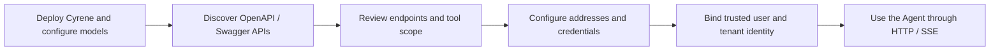
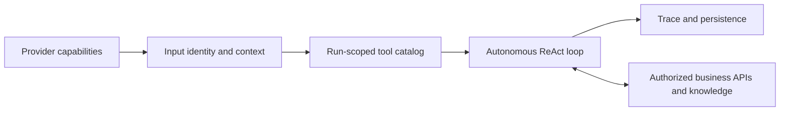

<div align="center">

# Cyrene Agent

**Help Agents understand and operate your business system.**

A framework for rapidly integrating Agents with existing business systems

[](https://github.com/chenkezhen480/Cyrene/actions/workflows/ci.yml) [](pom.xml) [](docs/PROJECT_STATUS.md) [](LICENSE)

[Quick start](#quick-start) · [Core capabilities](#core-capabilities) · [Puban case](docs/CASE_STUDY_PUBAN.md) · [Contributing](CONTRIBUTING.md) · [中文](README.md)

</div>

Cyrene is built with Java 21 on LangChain4j and provides an independently deployable Agent service. Existing projects connect through HTTP / SSE and reuse their business APIs, knowledge, identity, and authorization to build dedicated Agents that understand the business and perform authorized operations.

## Why Cyrene

Unlike Agents such as Claude Code and Codex, Cyrene is a general-purpose Agent development framework for existing systems.

An existing enterprise project already has business data, domain knowledge, APIs, and permission rules. Connecting an Agent raises two core questions:

| Core question | Integration challenge | Cyrene facilities |
|---|---|---|
| **How can the Agent understand your system?** | Documents, data, relationships, and experience are scattered; the model lacks relevant business context | Wiki, RAG, knowledge graphs, and memory organize existing data and supply relevant context |
| **How can the Agent operate your system?** | APIs need to become tools, and calls must preserve user identity, tenant scope, and business permissions | API discovery and review, generic HTTP tools, trusted identity binding, and business credential propagation |

Cyrene integrates the engineering facilities needed for both questions. **API integration enables business operations, knowledge and memory inform decisions, and Trace records supply data for business-specific fine-tuning.** Integrators can focus on domain knowledge, business rules, and the application experience.

## Rapid Integration and Engineering Comparison

### An Independent Service for Different Business Systems

The Agent service can be deployed separately. Business backends call it through HTTP / SSE without adopting the same language or application stack. Model configuration, API management, knowledge management, sessions, and the Trace console are available in the Agent service for reuse across projects.

The framework supports both single-tenant and multi-tenant business scopes. Single-tenant projects can use default tenant and identity values. Multi-tenant projects bind user, tenant, and identity through verified principals, applying those scopes to tool permissions, knowledge reads, and memory access. The host retains its own business authorization.

### Integration Steps



API discovery prefers OpenAPI / Swagger specifications. Without a specification, confined read-only source tools can discover endpoints. After developer review, saved configurations load as tools; APIs that fit the current contract can reuse the generic HTTP executor. See [version status](docs/PROJECT_STATUS.md) for authentication and endpoint support.

### Comparison with Spring AI Alibaba

This compares Cyrene's independent service with the official Spring AI Alibaba ReactAgent basic integration route. It focuses on **the engineering work needed to connect an existing project**.

| Dimension | Cyrene integrated facilities | Spring AI Alibaba ReactAgent route |
|---|---|---|
| Service deployment | Independent Agent service called through HTTP / SSE | Assemble the Agent with a Java SDK; the application organizes service endpoints and deployment |
| Understanding the system | Knowledge import, Wiki, graphs, preferences, and memory management | Combine RAG, Memory, and other components with business-specific data and storage |
| Business operations | OpenAPI discovery, review, hot reload, `HttpApiTool`, and credential injection | Wrap business calls with `ToolCallback`, annotated tools, or other extensions |
| Tenancy and identity | Default and trusted tenant scopes, with tool permissions configured by tenant and identity | Pass identity through `ToolContext` / `RunnableConfig`; the application organizes business scope |
| Development and debugging | Model settings, API and tool management, knowledge management, test conversations, and Trace console | Assemble models, tools, and runtime components; integrate Agent Chat UI and other ecosystem facilities |

Rapid integration comes from reusing common facilities. Integrators mainly configure models, review APIs, map identity, and validate business integration. Alibaba also offers extensions and independent applications. See its official [quick start](https://java2ai.com/docs/quick-start/), [tools and context](https://java2ai.com/docs/frameworks/agent-framework/tutorials/tools/), [RAG](https://java2ai.com/docs/frameworks/agent-framework/advanced/rag/), [Memory](https://java2ai.com/docs/frameworks/agent-framework/advanced/memory/), and [Agent Chat UI](https://java2ai.com/docs/frameworks/studio/quick-start/) documentation.

**Ongoing optimization:** There is a gap with Alibaba in speed and default input token optimization. Cyrene integrates a broader set of engineering facilities and will continue optimizing tool definitions, context size, and runtime overhead. Detailed results remain in the [independent comparison](docs/experiments/2026-10-13-alibaba-results.md) and [Wiki experiments](docs/experiments/2026-10-13-results.md).

## Core Capabilities

### API Integration: The Foundation for Business Operations

An Agent needs access to authorized business data to use an existing project. Cyrene turns API methods, paths, parameter schemas, and authentication configuration into tool definitions and uses a generic HTTP executor to make calls.

Calls use `context.credentials` supplied by a trusted backend, injected according to endpoint configuration. The host API checks user and data permissions. **Tool integration and inherited identity and permissions form the foundation for operating project data.** API configurations support review, saving, and hot reload; subsequent runs use the updated tool catalog.

<details>
<summary>Project API interface</summary>


</details>

### Knowledge and Memory: Using Existing Project Data

Project data includes documents, user experiences, operation methods, and relationships between business objects. Cyrene organizes these separately so an Agent can find relevant evidence for a task.

| Data | Role in business decisions | Use |
|---|---|---|
| Domain documents | Knowledge, rules, and explanations | Document conversion, chunking, and retrieval |
| Business graphs | Objects, relationships, and paths | Queries within authorized graph and Schema scope |
| User preferences | Interaction and expression habits | Activation by user and tenant before a request |
| User episodes | Historical facts and context | Retrieval and reads within user scope |
| Agent operation memory | Reusable methods, steps, and experience | Operation playbook organization and retrieval |

**Why optimize knowledge and memory weights?** Different tasks depend on different data. Adding all historical information increases context overhead and can obscure the facts a task needs. Preference activation, type and scope filtering, weighted RRF fusion of semantic and keyword retrieval, and configured document reranking prioritize relevant context and put existing project data to work.

`knowledge_search` discovers knowledge and returns signed handles. `knowledge_read` rechecks current revisions, lifecycle, and access scope before reading documents, memory, or graph routes. MySQL controls authoritative state, Milvus provides semantic projections, and Neo4j stores graph facts.

<details>
<summary>Wiki and knowledge-graph interfaces</summary>


</details>

### Single and Multiple Tenants: Inherited Identity and Permissions

A verified server principal binds user, tenant, and identity. Tool permissions are configured by tenant and identity. Each Agent run creates an immutable catalog so model-visible tools match authorized execution. Sub-agents inherit trusted context and narrow their scope within the parent run.

The mechanism accommodates single-tenant projects and multi-tenant systems, separating administrative discovery and code tools from business-user operations. Knowledge reads enforce data scope, while the host retains authorization for its APIs.

<details>
<summary>Tool permission interface</summary>


</details>

### Autonomous ReAct, Structured Output, and Sub-agents

The model selects tools, observes results, and continues or produces a response after inspection and reflection. Inspector checks errors, empty results, low relevance, and repeated calls. Recoverable knowledge results can trigger a single query-rewrite escalation.

A final JSON Schema can constrain machine-readable business responses, with returned values validated again. Sub-agents can perform independent tasks and have completion checked against tool allowlists, successful calls, typed artifacts, and final output contracts.

### Trace: A Second Use for Business Execution Data

Trace records input, model rounds, tool choices and results, errors, inspection and reflection, final responses, and feedback. Sub-agent traces link to their parent through `parent_trace_id`, reconstructing the task tree.

These records support debugging and, after scope filtering, de-identification, and review, form business-specific fine-tuning samples. **The samples optimize tool selection, operation steps, and decision weights for the corresponding business.** Execution data therefore has a second use.

Knowledge and memory weights affect the context supplied to the model. Trace-based fine-tuning optimizes business-specific model choices and parameters. The application and maintainers own data admission, domain evaluation, and the permitted use of the resulting model.

<details>
<summary>Trace console</summary>


</details>

### Configurable Models and Multimodal Capabilities

The main LLM, Vision, ASR / TTS, Embedding, Rerank, lightweight task model, and Realtime can use separately configured providers, models, and endpoints. Image and video generation use configured tools. Skills and MCP add domain methods and external tools as needed.

## Application Case: Puban

**Puban is a personalized growth Agent for autistic children, piloted in offline institutions with approximately 100+ users.** The project maintainer confirmed this status and user scale on October 14, 2026.

Puban turns professionally approved goals into picture books and interactive situations. Its workflow connects profile and goal reading, picture-book generation, manual selection and review, saving, interaction, and feedback. Cyrene supplies API tools, knowledge, memory, autonomous execution, and Trace. The host owns child profiles, IEPs (individualized education plans), professional review, and business authorization.

<p align="center">
  
  
</p>

[Puban workflow and framework responsibilities](docs/CASE_STUDY_PUBAN.md) (Chinese).

## Architecture



| Module | Responsibility |
|---|---|
| `harness-core` | Configuration, shared models, context, and runtime contracts |
| `harness-provider` | Chat, embedding, rerank, vision, voice, and model adapters |
| `harness-input` | Authentication, multimodal input, memory, and context preparation |
| `harness-tool` | Tool catalogs, HTTP APIs, MCP, Skills, knowledge, and graphs |
| `harness-react` | Model-tool loop, inspection, reflection, and termination |
| `harness-trace` | Execution records, storage, cleanup, and parent-child linkage |
| `harness-agent` | Orchestration, sessions, tool assembly, and sub-agents |
| `harness-server` | HTTP / SSE / WebSocket APIs and management console |

The framework remains domain-neutral. The integrating system provides business models, tenant identity sources, domain rules, and business authorization.

## Quick Start

### Docker Compose

```bash
cp .env.example .env
# Configure services and authentication; configure models in the Web console after startup
docker compose --env-file .env -f docker/docker-compose.yml up -d --build
```

The console uses `HARNESS_SERVER_PORT` (default `8080`). Docker dynamically assigns middleware host ports. Inspect actual mappings with the following command; mappings may change after container recreation.

```bash
docker compose --env-file .env -f docker/docker-compose.yml ps
```

### Local Build

```bash
mvn clean package -pl harness-server -am -DskipTests
java -jar harness-server/target/harness-server.jar
```

Java 21+ and Maven 3.8+ are required. Container deployment requires Docker and Docker Compose. Open the Web console to configure models, discover project APIs, upload knowledge, and validate business integration.

User-scoped APIs require JWT claims with complete identity or a trusted user adapter, plus business credentials supplied by a trusted backend. The default `Main` service-token route does not install a user adapter. See [integration limits](docs/PROJECT_STATUS.md#已知限制与待验收项) (Chinese) and [.env.example](.env.example).

## Status and Participation

- [Feature scope, verification records, and known limits](docs/PROJECT_STATUS.md) (Chinese)
- [Upstream attribution, human design responsibility, and maintenance](docs/GOVERNANCE.md) (Chinese)
- [Contributing](CONTRIBUTING.md), [code of conduct](CODE_OF_CONDUCT.md), and [security reporting](SECURITY.md) (Chinese)

The current maintenance contact is [@chenkezhen480](https://github.com/chenkezhen480). The root POM's `revision` defines the version. The CI badge shows the main-branch push workflow; verification scope is recorded on the status page.

## License

[Apache License 2.0](LICENSE). Third-party components, model services, and images retain their respective terms.
