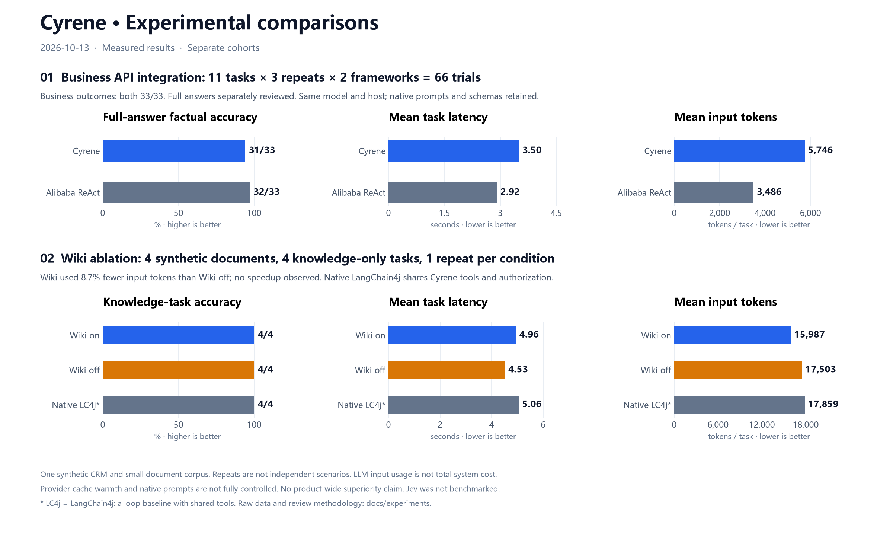

<p align="right"><a href="./README.md">中文</a></p>

# Cyrene Agent — A Dedicated Agent Framework for Existing Projects

## Rapid Integration and Experimental Comparisons

**Cyrene focuses on rapidly building dedicated Agents for existing business systems.** Built on LangChain4j, it integrates API discovery, generic HTTP tools, trusted credential propagation, autonomous ReAct, sessions, and tracing in one service. Once the existing backend exposes callable HTTP APIs, developers can reuse these capabilities and focus on model configuration, endpoint review, and identity mapping, reducing repeated integration and runtime-management work across projects.

### What Rapid Integration Saves


1. **Reuse existing APIs.** The console first scans OpenAPI/Swagger files in the project to extract methods, paths, and parameter schemas. Without a specification, confined read-only source tools can discover endpoints. After developer review, saving and loading the configuration wraps endpoints as callable tools, avoiding a separate HTTP Tool implementation for each API that fits the contract.
2. **Reuse existing identity and authorization.** Configure each endpoint's credential key and injection location. A trusted backend binds user/tenant identity and passes `context.credentials`; the generic tool propagates the appropriate credentials to business APIs. The host retains its data-access and business authorization checks, while integrators configure which Agent tools are available.
3. **Reuse Agent runtime facilities.** The ReAct loop, request-scoped tool catalog, sessions, tool-error feedback, and tracing are already integrated. Submit natural-language tasks through chat and let the model choose tools autonomously. Existing document upload and Wiki retrieval can supply domain knowledge when needed.

The five CRM endpoints in this experiment were integrated as follows:

| Integration work | Cyrene route tested | Spring AI Alibaba route tested |
|---|---|---|
| Expose business APIs as tools | Parse OpenAPI and reuse the generic `HttpApiTool` | Implement five annotated tools and register `ToolCallbacks` |
| Make HTTP requests and propagate user credentials | Configure service addresses, credential keys, and injection locations; reuse the executor | Implement HTTP requests and `ToolContext` credential access in an independent adapter |
| Run the Agent and trace operations | Use existing ReAct, session, and Trace services | Assemble the official ReactAgent, model, tools, and memory; separately record experiment behavior and usage |

**The measured part is an automated integration step:** Cyrene fetched and parsed five endpoints in **64, 45, and 51 ms** across three rounds. The experiment's registration method reused existing framework facilities and contained **18 nonblank lines**. Alibaba's independent CRM adapter contained **83 lines**, with another **54 lines** for model and Agent assembly. These scopes are not equivalent and do not establish a general code-saving percentage. The 45–64 ms timing covers only automated fetching and parsing; complete integration still requires deployment, configuration, endpoint review, identity mapping, and testing. Alibaba also supports other integration routes, including MCP, which were not tested here. End-to-end developer onboarding time has not been measured. [Integration code and timing scope](docs/experiments/2026-10-13-alibaba-results.md#接入工作量与初始化).

### Task Performance After Integration and Wiki Ablation



**Business API integration:** Cyrene and an independent Spring AI Alibaba ReactAgent each ran 11 tasks × 3 repeats against the same synthetic CRM and model. Both achieved **33/33 business outcomes**; full-answer factual review passed **31/33 and 32/33**, respectively. Mean latency was **3.50 s versus 2.92 s**, and mean input usage was **5,746 versus 3,486 tokens**. Alibaba had lower latency and input usage in this sample. Cyrene reused its OpenAPI importer, trusted credential propagation, and tool executor; developer onboarding time savings were not measured. [Full comparison, raw records, and review](docs/experiments/2026-10-13-alibaba-results.md).

**Wiki ablation:** Four synthetic documents, four knowledge-only tasks, and one repeat per condition. Wiki on/off both passed **4/4**, with mean input usage of **15,987 versus 17,503 tokens**, an **8.7% reduction** with Wiki on. Mean latency was **4.96 s versus 4.53 s**; no speedup was observed. The native LangChain4j condition shares Cyrene tools and authorization and serves only as a loop baseline. [Wiki experiment and limitations](docs/experiments/2026-10-13-results.md).

These experiments have separate cohorts, repetition counts, and feature scopes. Provider cache warmth was not fully controlled, and LLM input tokens do not represent total system cost. The results do not establish production generalization or product-wide superiority. Jev was not independently benchmarked.

> Add an autonomous ReAct Agent to an existing business system, its domain knowledge, and its authorization model instead of building an isolated AI application from scratch.

Cyrene Agent is an Agent development framework built with Java 21. It is designed for vertical-domain developers who need to give an existing system a natural-language interface, project API control, enterprise knowledge retrieval, relational-data retrieval, validated structured output, sub-agent collaboration, and end-to-end tracing.

## Why Cyrene Agent

Cyrene Agent addresses a different question: **how do you build a dedicated Agent for an existing system?**

Use case 1:
<table>
  <tr>
    <td></td>
    <td></td>
  </tr>
</table>

## Quick Start

### Docker Compose

```bash
cp .env.example .env
# Edit .env for service and authentication settings; configure chat and embedding models in the Web console after startup
docker compose --env-file .env -f docker/docker-compose.yml up -d --build
```

Docker dynamically assigns middleware host ports to avoid conflicts with local services; internal container addresses stay unchanged. The console uses `HARNESS_SERVER_PORT` (default `8080`), which must be available. Run `docker compose --env-file .env -f docker/docker-compose.yml ps` to see the actual mappings. Middleware host ports may change when containers are recreated.

### Local Build

```bash
mvn clean package -pl harness-server -am -DskipTests
java -jar harness-server/target/harness-server.jar
```

- The service listens on `8080` by default.
- The Web console covers model configuration, project API discovery, knowledge upload, knowledge-graph management, and test conversations with the Agent.
- An intranet deployment connected to the project backend is recommended.
- The tenant and identity, along with the `userId` and token credentials, arrive as context parameters on the chat API. Both have defaults, so you can shape them around your own system — the defaults target systems with no tenancy and no identity.

See [.env.example](./.env.example) for the complete configuration surface.

### Requirements

- Java 21+
- Maven 3.8+
- Docker and Docker Compose

## Core Capabilities

### 1. LLM wiki + RAG


Structure:
```text
                              Agent
          │                     │                     │
          ┌─────────────────────┼─────────────────────┐
          ▼                     ▼                     ▼
  knowledge_search       knowledge_read          query_graph
          │                     │                     │
          ▼                     ▼                     ▼
        Wiki                 MySQL                 Neo4j
       Milvus            authoritative data       graph data
          │
          ▼
          Document / Episode / Operation

          A Wiki may also carry a GRAPH_SCHEMA capability card
          │
          └──> reminding the Agent that query_graph is available
```
Memory and knowledge are split into distinct stores: Agent operation memory records the pitfalls hit while operating on your project; user scenario memory recalls context; vector documents hold vertical-domain knowledge chunks; the knowledge graph holds the real business relationships of the project's integrations; long-term preference memory records the user profile.

### 2. Tool Lists Isolated by Tenant and Identity


Tools are separated by design. If your users are consumers (ToC), they must not be given tools that control code — yet you still need those tools to generate the project's API integration tools. (Both tenant and identity default to values suited to an individual project.)

### 3. One-Click Integration with Project APIs


The project API integration window opens automatically on first launch. After configuration you can edit endpoints on the settings page. On later startups the API file is automatically wrapped as Agent tools — not a one-shot injection, but a tree of managed tools governed by an upstream tool.

## Main Modules

The architecture converges on **Provider → Input → ReAct Loop → Trace**, with Tool acting as the capability boundary between the loop and business systems.

### Provider

Provider is the composition boundary for model capabilities. It centers on the main LLM and tool-calling model while supporting independent Vision, ASR/TTS, Embedding, Rerank, Classifier, and Realtime capabilities. Image and video generation are connected through provider-configured generation tools. Each capability can use a different vendor, model, endpoint, and concurrency policy so enterprises can balance quality, cost, and data boundaries.

### Input

Input covers more than user text. It handles authentication, multimodal parsing, short- and long-term memory injection, context construction, and extensible request-level JSON Context. Integrators can provide trusted fields such as `userId`, `tenantId`, output mode, graph scope, and user credentials, allowing the Agent to inherit the identity, tenancy, and business scope of the host system.

### ReAct Loop

The ReAct Loop performs “model decision → tool call → tool-result inspection → next model decision or output.” Inspector and adaptive reflection use tool errors, empty results, low relevance, and repeated calls to guide the next action.

Tools can also expose structured result states that evolve later calls. For example, knowledge-base retrieval starts with a low-cost original query. If the result falls into a recoverable relevance range, the next round implicitly upgrades to query rewriting, multi-query, Step-back, and HyDE retrieval. Completely unrelated results, or a request that has already escalated, do not repeatedly pay the rewriting cost.

### Trace

Trace observes the complete run: input, model rounds, tool calls and results, inspection and reflection status, latency, token consumption, confirmation decisions, and final output. A sub-agent owns an independent trace linked to its parent through `parent_trace_id`, making the full task tree reconstructable.


## License

[Apache License 2.0](./LICENSE). Third-party dependencies remain subject to their respective licenses.
